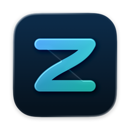

  

<h1 align="center">Zack</h1>

  <strong>Local push-to-talk dictation for macOS.</strong> 
  Hold a key, speak, release: the text appears at the cursor. Recognition and cleanup run on your Mac, no cloud.

  
  
  

## Highlights

- **On your Mac:** speech recognition with Parakeet Ultra, optional AI cleanup with Apple's on-device model. Audio
  and text stay in memory.
- **German or English:** one dictation language per user. The interface is in German or English and follows the
  macOS language; other languages get English.
- **Self-corrections smoothed:** with AI cleanup on, Apple's on-device model smooths a dictation such as "Tuesday,
  no, Wednesday".
- **Your words:** a dictionary for terms and spellings, and text snippets you insert by name.
- **Code mode:** in editors and terminals, spoken file names such as "readme dot md" and case commands become code.
- **Careful with your data:** no dictation into password fields, the clipboard is restored after inserting, and
  logs hold no dictated text.

## Install

Zack needs macOS 26 or later on Apple Silicon; AI cleanup needs Apple Intelligence turned on.

1. Download the latest `Zack-<version>.zip` from the [releases page](https://github.com/netclusive/zack/releases).
2. Open the ZIP and move `Zack.app` to the Applications folder, then start it.
3. Allow Microphone and Accessibility when asked.
4. "Settings › Setup" offers the speech model for download (about 600 MB, see [Privacy](#privacy)).

## Using Zack

Zack lives in the menu bar. Hold fn (or the right Option key), speak, release, and the text is inserted into the
active window.

### Dictation

- Hold the key ("Settings › General › Dictation key"), speak, release: Zack recognizes the speech, applies its text
  rules (dictionary, snippets) and inserts the result at the cursor. A short tap is ignored, and pressing another
  key while holding cancels, so shortcuts such as fn + arrow keep working.
- Language ("Settings › General › Dictation language"): Deutsch or English. On first start Zack follows the macOS
  language; an existing installation stays German. The text rules, AI cleanup, code mode and snippets follow the
  language, and a change applies from the next dictation.
- AI cleanup ("Settings › General › AI cleanup of self-corrections"): if a dictation contains a
  self-correction such as "Montag, nein, Dienstag" or "Tuesday, no, Wednesday", Apple's on-device model smooths
  the sentence.
- Pause playback ("Settings › General › Pause playback while dictating", on by default): if Spotify or a YouTube
  video in Chrome is playing when the pill appears, Zack pauses it and resumes it when the recording ends. Zack
  cannot tell paused players from playing ones directly, so after a dictation playback may also start that you paused
  yourself just before (up to about 2 seconds for Spotify, 10 for Chrome), or, if Chrome played another sound such
  as a notification in the last 10 seconds, the player macOS last used.
- Password fields: Zack does not dictate into them and shows a hint instead. While another app holds Secure Input,
  the menu shows "Secure Input Active"; dictation works, only canceling with another key does not.

### Keyboard shortcuts

| Shortcut | Action |
|---|---|
| Hold fn or the right ⌥ (Option) key | Dictate (change the key in "Settings › General › Dictation key") |
| Esc | While the pill shows "Recognizing…" or "Cleaning Up…": cancel; nothing is inserted, the result is kept as the last dictation |
| ⌃⌥V | Insert the last dictation again at the cursor |
| ⌃⌥O | Replace the AI-cleaned dictation just inserted with the rule text; after 10 seconds or once the text has changed, the rule text is copied instead |

The menu section "Last Dictation" has the same actions ("Insert", "Insert Without AI Cleanup"), plus "Copy" and,
after a failed recognition, "Try Again". A shortcut another app already holds is marked "(Shortcut in Use)".

### Settings and permissions

- The settings window ("Settings…" in the menu, ⌘,) has the panes General (language, key, microphone
  readiness, launch at login, AI cleanup), Dictionary, Snippets, Code Apps, Updates and Setup. If a
  permission or the speech model is missing, Zack opens it in Setup.
- Permissions: Microphone, and Accessibility for inserting with Cmd+V, for reading the text before the cursor and
  for canceling with another key. The key itself works without Accessibility; the text then stays on the
  clipboard.
- Model: Parakeet Ultra in `~/Library/Application Support/Zack/Models`. "Settings › Setup" moves a copy from
  zack-bench (`~/Library/Application Support/FluidAudio/Models`) or downloads it on click (about 600 MB). The app
  never downloads on its own.

### Microphone

- Readiness ("Settings › General › Keep microphone ready"): by default the microphone stays open for two minutes
  after a dictation, so the first words are not cut off; "Always" keeps it open, "Off" closes it after each
  dictation.
- Choice (menu "Microphone: <device>"): "Same as macOS" follows the system input; picking a device applies to Zack only
  and leaves the macOS default untouched. If the chosen device is not connected, Zack uses the macOS default and
  switches back as soon as the device returns.

### Files

`vocabulary.txt`, `snippets.txt` and `code-apps.txt` live in `~/Library/Application Support/Zack` and are created
with examples in the dictation language; existing files stay as they are when the language changes. Lines
starting with `#` are ignored. Edit them in "Settings › Dictionary / Snippets / Code Apps" or in any text
editor: Zack changes only the lines you edit, keeps comments and lines it cannot read, and reloads a file changed
elsewhere.

- `vocabulary.txt`: one term per line, which Zack writes exactly as given and passes to the recognition as a hint;
  `wrong => right` replaces a spelling.
- `snippets.txt`: one snippet per line as `Name => Text`, `\n` for a line break; dictating "Baustein <Name>"
  (English: "snippet <name>") inserts the text. Known limits: a literal `\n` in snippet text becomes a line
  break, and spaces at the start and end of a field are dropped.
- `code-apps.txt`: the apps for code mode (bundle IDs, or prefixes ending in `*`). In these apps spoken file names
  ("readme punkt md", English "readme dot md") and case commands become code, and short commands get no trailing
  period. The menu switches the current app on or off, "Settings › Code Apps" adds apps; the file is read again
  for every dictation.

## Privacy

- **Audio and text** stay in memory, the clipboard entry is marked transient and restored afterwards, and logs
  contain durations, engines and error types only. AI cleanup uses Apple's on-device model only.
- **Text before the cursor** (needs Accessibility): Zack reads it to add a space and adapt capitalization, at most
  the 500 characters before the cursor, or the field text up to 100,000 characters if the app offers nothing
  narrower, and keeps only the current line of it. It stays in memory only, is never logged and is dropped when
  the dictation ends. Where an app does not expose it, Zack falls back to its last own dictation until the next key
  press, the next click or an app switch.
- **Microphone readiness:** while the microphone is open between dictations, only the last half second is kept in
  memory, continuously overwritten, never recognized or stored, and macOS shows the orange microphone indicator.
- **Playback pause:** to see whether Spotify or Chrome is playing, Zack asks macOS which apps are sending audio
  right now (app identifiers only, no titles). It pauses and resumes them through MediaRemote, a non-public macOS
  interface. The app identifiers are neither stored nor logged; the log only notes that Zack paused and resumed. A
  macOS update may stop the feature without notice; dictation is not affected.
- **Network:** Zack goes online only for two things.
  - The model download you start in "Settings › Setup", from Hugging Face (USA). The request carries your IP
    address, the app and macOS version and your preferred languages. If `HF_TOKEN`, `HUGGING_FACE_HUB_TOKEN` or
    `HUGGINGFACEHUB_API_TOKEN` is set, it is also sent to Hugging Face as a token.
  - In official builds, the update check you allow. Feed and downloads come from GitHub (GitHub Inc., USA). A
    request carries your IP address, your preferred languages and the user agent `Zack/<version> Sparkle/<version>`;
    Sparkle sends no system profile.

## Updates

Official builds update themselves through [Sparkle](https://sparkle-project.org). On the second launch Zack asks
whether it may check for updates; the prompt has a checkbox for automatic installing. After you agree, it checks
once a day. The switches are in "Settings › Updates", "Check for Updates…" is in the menu:

- "Check for Updates…" (menu) and "Check Now" (settings) check right away.
- "Automatically check for updates" turns the daily check on or off.
- "Automatically install updates" downloads in the background and installs when Zack quits.
- "Update to <version>…" appears when an update waits (with automatic installing off); a click shows the update
  and its changes.

What a check sends is listed under [Privacy](#privacy).

## Development

Building from source, the quality gate, releases and the benchmark tool `zack-bench`, which compares recognition and
cleanup engines on a test corpus, are described in [docs/development.md](docs/development.md).

## License

Apache License 2.0, see [LICENSE](LICENSE). The Zack name and logo and the netclusive name and brand are not
licensed under it.

## Publisher

netclusive GmbH. [Imprint](https://www.netclusive.de/impressum),
[privacy policy](https://www.netclusive.de/datenschutz). No guaranteed support.
